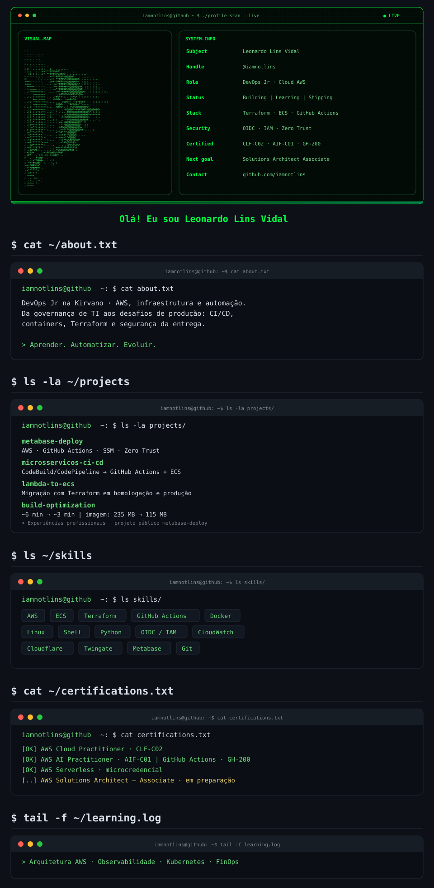

  

  <a href="https://www.linkedin.com/in/leonardolinsvidal">LinkedIn</a>
  &nbsp; · &nbsp;
  <a href="mailto:leonardolinsvv17@gmail.com">E-mail</a>
  &nbsp; · &nbsp;
  <a href="https://github.com/iamnotlins">GitHub</a>

## `$ whoami`

Sou **Leonardo Lins Vidal**, **DevOps Jr na Kirvano**, com foco em cloud AWS, infraestrutura e automação de entregas em produção.

Comecei na governança de TI e evoluí para DevOps na prática, resolvendo problemas reais. Hoje trabalho com pipelines de CI/CD, containers, migração de workloads para ECS e segurança da entrega, buscando reduzir tempo de build, tamanho de imagens e tarefas manuais.

## `$ cat ~/impact.log`

<table>
  <tr>
    <th>⚡ Tempo de build</th>
    <th>📦 Imagem de produção</th>
    <th>🔐 Autenticação AWS</th>
  </tr>
  <tr>
    <td align="center"><strong>~6 min → ~3 min</strong> ~50% de redução</td>
    <td align="center"><strong>235 MB → 115 MB</strong> ~51% de redução</td>
    <td align="center"><strong>OIDC + IAM Roles</strong> Sem chaves de longa duração nos pipelines</td>
  </tr>
</table>

## `$ ls -la ~/experience`

**Kirvano · DevOps Jr**  
Atuação em DevOps desde março de 2026 · promoção formal em julho de 2026.

| Frente | O que construí |
| :--- | :--- |
| **CI/CD de microsserviços** | Migração de AWS CodeBuild/CodePipeline para GitHub Actions em staging, QA e produção, com lint, testes, migrations automáticas e deploy paralelo de serviços no ECS. |
| **Otimização de builds** | Cache BuildKit/GHA e Yarn 4 para reduzir o tempo de build de aproximadamente 6 para 3 minutos. |
| **Containers** | Dockerfile multi-stage, imagem base fixada por digest e remoção de devDependencies/sourcemaps: imagem de produção de 235 MB para 115 MB. |
| **Segurança da entrega** | OIDC, Actions fixadas por SHA e IAM Roles com permissões mínimas por ambiente. |
| **Infraestrutura AWS** | Migração de Lambda/API Gateway para ECS com Terraform em homologação e produção. |
| **Metabase** | Implantação na AWS com CI/CD, SSH Deploy Key, AWS SSM e acesso via Zero Trust com Twingate/Cloudflare. |
| **Organização e segurança** | Tagging de recursos AWS como base para observabilidade e FinOps; correção de vulnerabilidades em homologação. |

## `$ ls ~/stack`

| Área | Tecnologias e práticas |
| :--- | :--- |
| **Cloud e infraestrutura** | AWS · ECS · EC2 · Lambda · API Gateway · CloudWatch · SSM · IAM |
| **Entrega e containers** | GitHub Actions · Docker · BuildKit · Git |
| **Infraestrutura como código** | Terraform |
| **Sistemas e automação** | Linux · Nginx · Shell Script · Python |
| **Segurança e acesso** | OIDC · IAM Roles · Cloudflare · Twingate |
| **Em aprofundamento** | Arquitetura AWS · Observabilidade · Kubernetes · FinOps |

## `$ cat ~/certifications.txt`

| Certificação / credencial | Status |
| :--- | :--- |
| **AWS Certified Cloud Practitioner · CLF-C02** | ✅ Concluída |
| **AWS Certified AI Practitioner · AIF-C01** | ✅ Concluída |
| **GitHub Actions · GH-200** | ✅ Concluída |
| **AWS Serverless · microcredencial** | ✅ Concluída |
| **AWS Certified Solutions Architect – Associate · SAA** | 📚 Em preparação |

<strong>$ cat ~/education.txt</strong> · Formação e estudos complementares

- **Gestão de TI** — UNINOVE
- **Técnico em Desenvolvimento de Sistemas** — ETEC / Centro Paula Souza
- **DevOps Pro** — GitHub Actions e Docker
- **Scrum Foundation** — CertiProf
- **Networking Basics** — Cisco
- **Redes de Computadores** — Alura

## `$ ls ~/projects/public`

### [metabase-deploy](https://github.com/iAmNotLins/metabase-deploy)

Projeto público de implantação do Metabase, conectando infraestrutura e automação de deploy.

## `$ tail -f ~/learning.log`

- **Próxima certificação:** AWS Solutions Architect – Associate.
- **Arquitetura:** entender os requisitos e as escolhas por trás de cada serviço AWS.
- **Observabilidade:** conectar métricas, logs e alertas ao diagnóstico de problemas.
- **Evolução contínua:** aprofundar IaC, Kubernetes e práticas de confiabilidade.

## `$ ssh connect`

Sempre aberto a trocar experiências sobre **AWS, automação e cultura DevOps**.

**[LinkedIn](https://www.linkedin.com/in/leonardolinsvidal)** · **[E-mail](mailto:leonardolinsvv17@gmail.com)** · **[GitHub](https://github.com/iamnotlins)**

---

Aprender. Automatizar. Evoluir.

